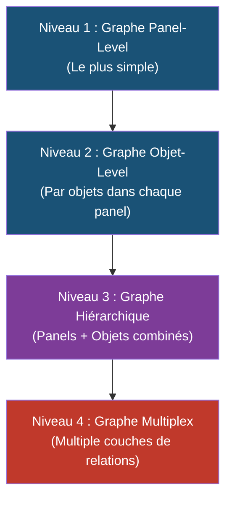

# Guide Complet : Architecture Neuro-Symbolique CNN + GNN + HRI pour RAVEN

**Projet :** Résolution des problèmes RPM (Raven's Progressive Matrices) via approche Neuro-Symbolique  
**Auteur :** DhiaEddine Saidi — Thèse sous la direction de Dr. Haythem Ghazouani  
**Dernière mise à jour :** 18 Avril 2026

---

## Table des Matières

1. [Vue d'Ensemble de l'Architecture](#1-vue-densemble-de-larchitecture)
2. [Rappel : Structure du Dataset RAVEN](#2-rappel--structure-du-dataset-raven)
3. [Étape 1 — Le CNN : Encodeur Visuel](#3-étape-1--le-cnn--encodeur-visuel)
4. [Étape 2 — Représentation en Graphe des RPM](#4-étape-2--représentation-en-graphe-des-rpm)
5. [Étape 3 — Le GNN : Raisonneur Relationnel](#5-étape-3--le-gnn--raisonneur-relationnel)
6. [Étape 4 — Le HRI : Inducteur de Règles Hiérarchiques](#6-étape-4--le-hri--inducteur-de-règles-hiérarchiques)
7. [Étape 5 — Sortie Conjointe et Entraînement](#7-étape-5--sortie-conjointe-et-entraînement)
8. [Plan d'Implémentation Progressif](#8-plan-dimplémentation-progressif)
9. [Références Clés](#9-références-clés)

---

## 1. Vue d'Ensemble de l'Architecture

L'idée centrale est de construire un pipeline en 3 modules coopérants, chacun jouant un rôle précis :

```
┌─────────────────────────────────────────────────────────────────────┐
│                    PIPELINE COMPLET                                 │
│                                                                     │
│  ┌──────────┐     ┌──────────────────┐     ┌───────────────────┐   │
│  │   CNN    │────▶│  Constructeur    │────▶│     GNN           │   │
│  │ Encodeur │     │  de Graphe       │     │  Message Passing  │   │
│  │ Visuel   │     │  (Graph Builder) │     │  (Rasonneur)      │   │
│  └──────────┘     └──────────────────┘     └────────┬──────────┘   │
│       │                                              │              │
│  Pixels → Embeddings                    Embeddings relationnels    │
│                                                      │              │
│                                              ┌───────▼──────────┐  │
│                                              │      HRI         │  │
│                                              │  Inducteur de    │  │
│                                              │  Règles Logiques │  │
│                                              └───────┬──────────┘  │
│                                                      │              │
│                                              ┌───────▼──────────┐  │
│                                              │    SORTIE        │  │
│                                              │  Réponse + Règle │  │
│                                              └──────────────────┘  │
└─────────────────────────────────────────────────────────────────────┘
```

### Flux de données simplifié

```
Image Panel (160×160 pixels)
    │
    ▼ CNN (par panel indépendamment)
Feature Vector (ex: 512-d)
    │
    ▼ Construction du Graphe
Graphe G = (V, E) avec attributs
    │
    ▼ GNN (Message Passing)
Embeddings relationnels enrichis
    │
    ▼ HRI (Soft Unification + Méta-Règles)
Règle logique + Score de réponse
```

### Pourquoi 3 modules séparés ?

| Module | Rôle | Analogie Humaine |
|--------|------|-----------------|
| **CNN** | Perception : "Que vois-je ?" | L'œil qui identifie les formes |
| **GNN** | Relation : "Comment sont-elles liées ?" | Le cortex qui compare les objets |
| **HRI** | Raisonnement : "Quelle est la règle ?" | Le raisonnement abstrait |

> [!IMPORTANT]
> Le CNN ne prédit **jamais** la réponse directement. Il sert uniquement d'extracteur de features. C'est le GNN + HRI qui raisonnent.

---

## 2. Rappel : Structure du Dataset RAVEN

### 2.1 La Grammaire A-SIG (Attributed Stochastic Image Grammar)

Chaque image RAVEN est structurée hiérarchiquement via la grammaire A-SIG :

```
Scene (Scène)
  └── Structure (ex: center_single, distribute_four, ...)
        └── Component(s) (1 ou 2 composants)
              └── Layout
                    ├── Number (nombre d'entités : 1-9)
                    ├── Position (positions spatiales)
                    ├── Uniformity (uniformité des entités)
                    └── Entity(ies) (les objets visuels)
                          ├── Type (triangle, square, pentagon, hexagon, circle)
                          ├── Size (0.4, 0.5, 0.6, 0.7, 0.8, 0.9)
                          ├── Color (255, 224, 196, 168, 140, 112, 84, 56, 28, 0)
                          └── Angle (-135, -90, -45, 0, 45, 90, 135, 180)
```

### 2.2 Les 4 Types de Règles

Les règles gouvernent comment les attributs changent **d'une ligne à l'autre** (Row-wise) dans la matrice 3×3 :

| Règle | Description | Exemple |
|-------|-------------|---------|
| **Constant** | L'attribut reste identique sur la ligne | Taille: [0.5, 0.5, 0.5] |
| **Progression** | L'attribut change par pas fixe (+1 ou -1 dans l'index) | Couleur: [255, 224, 196] |
| **Arithmetic** | Addition/soustraction entre colonnes (col1 ⊕ col2 = col3) | Nombre: [2, 3, 5] |
| **Distribute_Three** | Les 3 valeurs de la ligne forment un ensemble permuté | Type: {△, □, ○} dans n'importe quel ordre |

### 2.3 Les 7 Configurations

| Configuration | Structure | Nb Composants | Complexité |
|--------------|-----------|---------------|------------|
| center_single | 1 objet centré | 1 | ★ |
| distribute_four | grille 2×2 | 1 | ★★ |
| distribute_nine | grille 3×3 | 1 | ★★★ |
| left_right | gauche + droite | 2 | ★★ |
| up_down | haut + bas | 2 | ★★ |
| out_in_center | extérieur + intérieur centré | 2 | ★★ |
| out_in_grid | extérieur + intérieur grille 2×2 | 2 | ★★★ |

### 2.4 Structure d'un Problème RPM

```
Matrice 3×3 :                    Candidats :
┌─────┬─────┬─────┐             ┌───┬───┬───┬───┬───┬───┬───┬───┐
│ P1  │ P2  │ P3  │  Ligne 1    │C0 │C1 │C2 │C3 │C4 │C5 │C6 │C7 │
├─────┼─────┼─────┤             └───┴───┴───┴───┴───┴───┴───┴───┘
│ P4  │ P5  │ P6  │  Ligne 2     Une seule est correcte (target)
├─────┼─────┼─────┤
│ P7  │ P8  │ ?   │  Ligne 3
└─────┴─────┴─────┘

Fichier NPZ : images (16, 160, 160) = 8 contexte + 8 candidats
Fichier XML : structure A-SIG + règles pour les 16 panels
```

---

## 3. Étape 1 — Le CNN : Encodeur Visuel

### 3.1 Rôle Exact du CNN

Le CNN a un rôle précis et limité : **transformer chaque image de panel (160×160 pixels en niveaux de gris) en un vecteur de caractéristiques dense** (un "embedding") qui capture les propriétés visuelles des objets présents.

```
Panel Image (160×160×1)  ──▶  CNN  ──▶  Feature Vector (d-dim)
                                         ex: [0.23, -0.41, 0.87, ...]
                                              ↑
                                         Encode implicitement :
                                         - Quelles formes sont présentes
                                         - Leur taille approximative
                                         - Leur couleur/teinte
                                         - Leur position relative  
```

> [!NOTE]
> Le CNN traite **chaque panel indépendamment**. Il ne voit jamais la matrice complète. C'est le GNN qui capturera les relations inter-panels.

### 3.2 Choix d'Architecture CNN

Il y a 3 options principales, du plus simple au plus puissant :

#### Option A : CNN Simple à 4 couches (Recommandé pour démarrer)

C'est l'approche la plus légère et suffisante pour RAVEN car les images sont simples (formes géométriques en niveaux de gris).

```python
import torch
import torch.nn as nn

class SimpleRAVENCNN(nn.Module):
    """
    CNN léger pour extraire des features des panels RAVEN.
    Input:  (batch, 1, 160, 160) — image en niveaux de gris
    Output: (batch, embedding_dim) — vecteur de caractéristiques
    """
    def __init__(self, embedding_dim=256):
        super().__init__()
        
        self.features = nn.Sequential(
            # Bloc 1 : 160×160 → 80×80
            nn.Conv2d(1, 32, kernel_size=3, stride=1, padding=1),
            nn.BatchNorm2d(32),
            nn.ReLU(inplace=True),
            nn.MaxPool2d(2, 2),
            
            # Bloc 2 : 80×80 → 40×40
            nn.Conv2d(32, 64, kernel_size=3, stride=1, padding=1),
            nn.BatchNorm2d(64),
            nn.ReLU(inplace=True),
            nn.MaxPool2d(2, 2),
            
            # Bloc 3 : 40×40 → 20×20
            nn.Conv2d(64, 128, kernel_size=3, stride=1, padding=1),
            nn.BatchNorm2d(128),
            nn.ReLU(inplace=True),
            nn.MaxPool2d(2, 2),
            
            # Bloc 4 : 20×20 → 10×10
            nn.Conv2d(128, 256, kernel_size=3, stride=1, padding=1),
            nn.BatchNorm2d(256),
            nn.ReLU(inplace=True),
            nn.MaxPool2d(2, 2),
        )
        
        # Global Average Pooling : 10×10×256 → 256
        self.global_pool = nn.AdaptiveAvgPool2d((1, 1))
        
        # Projection vers l'espace d'embedding souhaité
        self.projection = nn.Sequential(
            nn.Linear(256, embedding_dim),
            nn.ReLU(inplace=True),
        )
    
    def forward(self, x):
        """
        x: (batch, 1, 160, 160) — un seul panel
        return: (batch, embedding_dim)
        """
        x = self.features(x)           # (batch, 256, 10, 10)
        x = self.global_pool(x)         # (batch, 256, 1, 1)
        x = x.view(x.size(0), -1)      # (batch, 256)
        x = self.projection(x)          # (batch, embedding_dim)
        return x
```

#### Option B : ResNet-18 (Recommandé pour des performances optimales)

```python
import torchvision.models as models

class ResNetRAVENCNN(nn.Module):
    """
    ResNet-18 modifié pour les images RAVEN en niveaux de gris.
    On retire la couche de classification finale.
    """
    def __init__(self, embedding_dim=256):
        super().__init__()
        
        # Charger ResNet-18 pré-entraîné
        resnet = models.resnet18(pretrained=True)
        
        # Modifier la première couche pour accepter 1 canal (gris)
        # au lieu de 3 (RGB)
        resnet.conv1 = nn.Conv2d(1, 64, kernel_size=7, stride=2, 
                                  padding=3, bias=False)
        
        # Retirer la couche de classification finale (fc)
        self.backbone = nn.Sequential(*list(resnet.children())[:-1])
        
        # Projection
        self.projection = nn.Linear(512, embedding_dim)
    
    def forward(self, x):
        x = self.backbone(x)            # (batch, 512, 1, 1)
        x = x.view(x.size(0), -1)      # (batch, 512)
        x = self.projection(x)          # (batch, embedding_dim)
        return x
```

#### Option C : CNN avec détection d'objets (Pour représentation objet-par-objet)

Si on veut un graphe au niveau des **objets individuels** (pas juste des panels), on peut utiliser un CNN avec un mécanisme d'attention spatiale qui extrait des features par "slot" d'objet.

```python
class SlotAttentionCNN(nn.Module):
    """
    CNN qui extrait des vecteurs séparés pour chaque objet/slot 
    dans l'image via un mécanisme d'attention.
    
    Utile si on veut construire un graphe au niveau objet.
    """
    def __init__(self, num_slots=9, slot_dim=64):
        super().__init__()
        self.num_slots = num_slots
        self.slot_dim = slot_dim
        
        # Extracteur de feature map
        self.backbone = nn.Sequential(
            nn.Conv2d(1, 32, 3, 1, 1), nn.ReLU(),
            nn.Conv2d(32, 64, 3, 2, 1), nn.ReLU(),  # 80×80
            nn.Conv2d(64, 64, 3, 2, 1), nn.ReLU(),   # 40×40
            nn.Conv2d(64, 64, 3, 2, 1), nn.ReLU(),   # 20×20
        )
        
        # Slots initiaux (apprenables)
        self.slot_mu = nn.Parameter(torch.randn(1, num_slots, slot_dim))
        
        # Attention : feature_map → slot assignments
        self.attn_key = nn.Linear(64, slot_dim)
        self.attn_query = nn.Linear(slot_dim, slot_dim)
        
    def forward(self, x):
        B = x.size(0)
        feat = self.backbone(x)                  # (B, 64, 20, 20)
        feat = feat.flatten(2).permute(0, 2, 1)  # (B, 400, 64)
        
        keys = self.attn_key(feat)    # (B, 400, slot_dim)
        queries = self.attn_query(
            self.slot_mu.expand(B, -1, -1)
        )                              # (B, num_slots, slot_dim)
        
        # Attention scores
        attn = torch.softmax(
            torch.bmm(queries, keys.transpose(1, 2)) / (self.slot_dim ** 0.5),
            dim=-1
        )                             # (B, num_slots, 400)
        
        # Agréger les features par slot
        slots = torch.bmm(attn, feat) # (B, num_slots, 64)
        
        return slots  # Chaque slot = 1 objet potentiel
```

### 3.3 Comment le CNN se connecte au reste

```python
def encode_all_panels(cnn, images):
    """
    Encode les 16 panels d'un problème RAVEN.
    
    images: (16, 160, 160) — numpy array du fichier NPZ
    return: context_emb (8, d), candidates_emb (8, d)
    """
    # Préparer les tenseurs
    panels = torch.tensor(images, dtype=torch.float32)
    panels = panels.unsqueeze(1)  # (16, 1, 160, 160)
    panels = panels / 255.0       # Normaliser [0, 1]
    
    # Encoder tous les panels en une passe
    with torch.no_grad():  # ou sans .no_grad() si en entraînement
        embeddings = cnn(panels)  # (16, embedding_dim)
    
    context = embeddings[:8]      # 8 panels de contexte
    candidates = embeddings[8:]   # 8 candidats réponse
    
    return context, candidates
```

### 3.4 Résumé des choix CNN

| Critère | Simple CNN (4 couches) | ResNet-18 | Slot Attention |
|---------|----------------------|-----------|----------------|
| Complexité | ★ | ★★ | ★★★ |
| Performance | Bonne pour RAVEN | Meilleure | Dépend de la tâche |
| Pré-entraîné ? | Non | Oui (ImageNet) | Non |
| Output | 1 vecteur/panel | 1 vecteur/panel | N vecteurs/panel (par objet) |
| Quand l'utiliser | Prototype initial | Baseline solide | Graphe niveau objet |

> [!TIP]
> **Recommandation :** Commencer avec le **CNN Simple (Option A)** pour le prototypage rapide. Passer à **ResNet-18 (Option B)** une fois le pipeline fonctionnel pour améliorer les performances.

---

## 4. Étape 2 — Représentation en Graphe des RPM

C'est la partie la **plus critique** et la plus sujette à des choix de conception. Il y a plusieurs approches possibles, du graphe le plus simple au plus expressif.

### 4.1 Les 4 Niveaux de Représentation en Graphe



---

### 4.2 Niveau 1 : Graphe Panel-Level (Recommandé pour démarrer)

C'est l'approche la plus intuitive : **chaque panel = 1 nœud**, et les arêtes représentent les relations structurelles de la matrice.

#### Concept

```
Nœuds : 8 panels de contexte (P1...P8) + 1 candidat à tester
         Chaque nœud est le feature vector produit par le CNN

Arêtes : Les relations de la matrice 3×3

         Arêtes de ligne (même ligne, même règle) :
         P1 ↔ P2 ↔ P3   (Ligne 1)
         P4 ↔ P5 ↔ P6   (Ligne 2)
         P7 ↔ P8 ↔ C?   (Ligne 3, avec candidat)

         Arêtes de colonne (même position, même transformation) :
         P1 ↔ P4 ↔ P7   (Colonne 1)
         P2 ↔ P5 ↔ P8   (Colonne 2)
         P3 ↔ P6 ↔ C?   (Colonne 3, avec candidat)
```

#### Visualisation du graphe

```
          Ligne 1         Ligne 2        Ligne 3
        ┌───────┐       ┌───────┐      ┌───────┐
        │       │       │       │      │       │
    P1 ─── P2 ─── P3   P4 ─── P5 ─── P6   P7 ─── P8 ─── C?
    │       │      │    │       │      │    │       │      │
    └───────┼──────┘    └───────┼──────┘    └───────┼──────┘
            │                   │                   │
       Colonne 1          Colonne 2           Colonne 3
```

#### Implémentation PyTorch Geometric

```python
import torch
from torch_geometric.data import Data

def build_panel_level_graph(context_embeddings, candidate_embedding):
    """
    Construit un graphe Panel-Level pour un problème RPM.
    
    context_embeddings: (8, d) — embeddings des 8 panels contexte
    candidate_embedding: (1, d) — embedding d'un candidat à tester
    
    return: torch_geometric.data.Data
    """
    # Nœuds : 9 panels (8 contexte + 1 candidat)
    # Index : P1=0, P2=1, P3=2, P4=3, P5=4, P6=5, P7=6, P8=7, C=8
    x = torch.cat([context_embeddings, candidate_embedding], dim=0)  # (9, d)
    
    # Arêtes (non-dirigées, donc dans les deux sens)
    # Relations de LIGNE (même ligne dans la matrice)
    row_edges = [
        # Ligne 1 : P1-P2-P3
        [0, 1], [1, 0], [1, 2], [2, 1], [0, 2], [2, 0],
        # Ligne 2 : P4-P5-P6
        [3, 4], [4, 3], [4, 5], [5, 4], [3, 5], [5, 3],
        # Ligne 3 : P7-P8-C?
        [6, 7], [7, 6], [7, 8], [8, 7], [6, 8], [8, 6],
    ]
    
    # Relations de COLONNE
    col_edges = [
        # Colonne 1 : P1-P4-P7
        [0, 3], [3, 0], [3, 6], [6, 3], [0, 6], [6, 0],
        # Colonne 2 : P2-P5-P8
        [1, 4], [4, 1], [4, 7], [7, 4], [1, 7], [7, 1],
        # Colonne 3 : P3-P6-C?
        [2, 5], [5, 2], [5, 8], [8, 5], [2, 8], [8, 2],
    ]
    
    all_edges = row_edges + col_edges
    edge_index = torch.tensor(all_edges, dtype=torch.long).t()  # (2, num_edges)
    
    # Attributs d'arêtes : type de relation (0=ligne, 1=colonne)
    edge_type = torch.cat([
        torch.zeros(len(row_edges), dtype=torch.long),  # arêtes de ligne
        torch.ones(len(col_edges), dtype=torch.long),    # arêtes de colonne
    ])
    
    # Construire l'objet Data de PyG
    data = Data(
        x=x,                    # (9, d) features des nœuds
        edge_index=edge_index,  # (2, num_edges) connectivité
        edge_attr=edge_type,    # (num_edges,) type d'arête
    )
    
    return data
```

#### Avantages et Limites de ce niveau

| ✅ Avantages | ❌ Limites |
|-------------|-----------|
| Simple à implémenter | Ne capture pas les objets individuels |
| Peu de nœuds (9) = rapide | Perd l'information sur "quel objet change" |
| Compatible avec n'importe quel CNN | Moins expressif pour les règles complexes |
| Bon pour le prototypage | |

---

### 4.3 Niveau 2 : Graphe Objet-Level (Plus expressif)

Ici, chaque **objet individuel** dans chaque panel devient un nœud. C'est plus fidèle à la structure A-SIG.

#### Concept

```
Nœuds : Chaque entité (objet) extraite d'un panel
         Ex: Si P1 a 3 objets → 3 nœuds pour P1
         
         Attributs du nœud :
         - Type (one-hot: 6 valeurs)
         - Size (normalisé: 1 valeur)
         - Color (normalisé: 1 valeur)
         - Angle (normalisé: 1 valeur)
         - Position (2 valeurs: x, y)
         Total: ~11 dimensions par nœud

Arêtes INTRA-panel (spatiales) :
         Objets du même panel connectés entre eux
         → Capture "objets voisins", "à l'intérieur de", etc.

Arêtes INTER-panel (progression) :
         Objets correspondants entre panels d'une même ligne
         → Capture comment un objet ÉVOLUE d'un panel à l'autre
```

#### Visualisation

```
Panel P1                 Panel P2                 Panel P3
┌────────────┐          ┌────────────┐          ┌────────────┐
│  ○₁ ── △₂  │          │  ○₃ ── □₄  │          │  ○₅ ── ⬡₆  │
│  │         │          │  │         │          │  │         │
│  □₃       │          │  △₅       │          │  △₇       │
└────────────┘          └────────────┘          └────────────┘
     │                       │                       │
     └───── Arêtes inter ────┘───── Arêtes inter ────┘
            (○₁→○₃→○₅) : progression de couleur ?
            (△₂→□₄→⬡₆) : progression de type ?
```

#### Implémentation

```python
def build_object_level_graph(xml_data, cnn_or_attributes='attributes'):
    """
    Construit un graphe au niveau objet depuis les annotations XML.
    
    xml_data: dict — sortie de visualize_xml_structure()
    
    Deux modes :
    - 'attributes' : utilise directement les attributs XML (oracle)
    - 'cnn' : utilise le CNN Slot Attention pour extraire les features
    """
    nodes = []        # liste des features de chaque nœud
    edges = []        # liste des paires (source, destination)
    edge_types = []   # type de chaque arête
    node_to_panel = []  # mapping nœud → index de panel
    
    node_idx = 0
    panel_objects = {}  # panel_idx → liste d'indices de nœuds
    
    for panel_idx in range(8):  # 8 panels de contexte
        panel = xml_data['panels'][panel_idx]
        struct = panel['struct']
        panel_objects[panel_idx] = []
        
        for comp in struct.get('components', []):
            layout = comp.get('layout', {})
            entities = layout.get('entities', [])
            
            for ent in entities:
                # Construire le vecteur de features de l'entité
                # (dans le cas 'attributes' — on utilise les annotations XML)
                type_idx = TYPE_VALUES.index(ent.get('Type', 'none'))
                size_val = float(ent.get('Size', 0.5))
                color_val = int(ent.get('Color', 128)) / 255.0
                angle_val = (int(ent.get('Angle', 0)) + 180) / 360.0
                
                # One-hot pour le type (6 valeurs)
                type_onehot = [0.0] * 6
                type_onehot[type_idx] = 1.0
                
                # Feature vector complet
                feat = type_onehot + [size_val, color_val, angle_val]
                nodes.append(feat)
                
                panel_objects[panel_idx].append(node_idx)
                node_to_panel.append(panel_idx)
                node_idx += 1
        
        # --- Arêtes INTRA-panel (spatiales) ---
        # Connecter tous les objets du même panel entre eux (fully connected)
        obj_indices = panel_objects[panel_idx]
        for i in range(len(obj_indices)):
            for j in range(i + 1, len(obj_indices)):
                edges.append([obj_indices[i], obj_indices[j]])
                edges.append([obj_indices[j], obj_indices[i]])
                edge_types.extend([0, 0])  # 0 = arête spatiale intra-panel
    
    # --- Arêtes INTER-panel (progression par ligne) ---
    # Ligne 1: P1(0), P2(1), P3(2)
    # Ligne 2: P4(3), P5(4), P6(5)
    # Ligne 3: P7(6), P8(7), (+ candidat)
    lines = [[0, 1, 2], [3, 4, 5], [6, 7]]
    
    for line in lines:
        for step in range(len(line) - 1):
            p_curr = line[step]
            p_next = line[step + 1]
            
            # Connecter les objets correspondants entre panels consécutifs
            # Stratégie simple : correspondance par index (1er→1er, 2ème→2ème)
            objs_curr = panel_objects[p_curr]
            objs_next = panel_objects[p_next]
            
            for k in range(min(len(objs_curr), len(objs_next))):
                edges.append([objs_curr[k], objs_next[k]])
                edges.append([objs_next[k], objs_curr[k]])
                edge_types.extend([1, 1])  # 1 = arête de progression
    
    # Convertir en tenseurs PyG
    x = torch.tensor(nodes, dtype=torch.float32)
    edge_index = torch.tensor(edges, dtype=torch.long).t() if edges else torch.zeros(2, 0, dtype=torch.long)
    edge_attr = torch.tensor(edge_types, dtype=torch.long)
    
    data = Data(x=x, edge_index=edge_index, edge_attr=edge_attr)
    data.node_to_panel = torch.tensor(node_to_panel, dtype=torch.long)
    
    return data

# Constantes utilisées
TYPE_VALUES = ["none", "triangle", "square", "pentagon", "hexagon", "circle"]
```

---

### 4.4 Niveau 3 : Graphe Hiérarchique (Combiné)

Ce niveau **combine** les niveaux Panel et Objet en une structure hiérarchique à 2 étages.

#### Concept

```
Étage Supérieur (Panel-Level) :
    [Panel₁] ── [Panel₂] ── [Panel₃]     (arêtes de ligne)
    [Panel₄] ── [Panel₅] ── [Panel₆]
    [Panel₇] ── [Panel₈] ── [Candidat]
        |            |           |         (arêtes de colonne)

              ↕ Arêtes hiérarchiques "contient"

Étage Inférieur (Objet-Level) :
    [Obj₁₁]─[Obj₁₂]  [Obj₂₁]─[Obj₂₂]  ...  (arêtes intra-panel)
    (objects de P1)    (objets de P2)
```

#### Implémentation avec HeteroData (PyG)

```python
from torch_geometric.data import HeteroData

def build_hierarchical_graph(context_embeddings, xml_data):
    """
    Graphe hiérarchique avec 2 types de nœuds : 'panel' et 'object'.
    
    context_embeddings: (8, d) — sorties du CNN
    xml_data: dict — annotations XML parsées
    """
    data = HeteroData()
    
    # === NŒUDS PANEL ===
    data['panel'].x = context_embeddings  # (8, d)
    
    # === NŒUDS OBJET ===
    object_features = []
    panel_to_objects = {}  # panel_idx → range d'indices objets
    obj_idx = 0
    
    for panel_idx in range(8):
        panel = xml_data['panels'][panel_idx]
        panel_to_objects[panel_idx] = []
        
        for comp in panel['struct'].get('components', []):
            for ent in comp.get('layout', {}).get('entities', []):
                type_idx = TYPE_VALUES.index(ent.get('Type', 'none'))
                type_oh = [0.0] * 6
                type_oh[type_idx] = 1.0
                feat = type_oh + [
                    float(ent.get('Size', 0.5)),
                    int(ent.get('Color', 128)) / 255.0,
                    (int(ent.get('Angle', 0)) + 180) / 360.0,
                ]
                object_features.append(feat)
                panel_to_objects[panel_idx].append(obj_idx)
                obj_idx += 1
    
    data['object'].x = torch.tensor(object_features, dtype=torch.float32)
    
    # === ARÊTES PANEL ↔ PANEL (ligne et colonne) ===
    row_edges = [[0,1],[1,2],[3,4],[4,5],[6,7]]
    col_edges = [[0,3],[3,6],[1,4],[4,7],[2,5]]
    all_panel_edges = row_edges + col_edges
    src = [e[0] for e in all_panel_edges]
    dst = [e[1] for e in all_panel_edges]
    data['panel', 'same_row_or_col', 'panel'].edge_index = torch.tensor(
        [src + dst, dst + src], dtype=torch.long
    )  # non-dirigé
    
    # === ARÊTES PANEL → OBJET (contient) ===
    contains_src, contains_dst = [], []
    for p_idx, obj_indices in panel_to_objects.items():
        for o_idx in obj_indices:
            contains_src.append(p_idx)
            contains_dst.append(o_idx)
    data['panel', 'contains', 'object'].edge_index = torch.tensor(
        [contains_src, contains_dst], dtype=torch.long
    )
    
    # === ARÊTES OBJET ↔ OBJET (intra-panel, spatiales) ===
    spatial_src, spatial_dst = [], []
    for p_idx, obj_indices in panel_to_objects.items():
        for i in range(len(obj_indices)):
            for j in range(i+1, len(obj_indices)):
                spatial_src.extend([obj_indices[i], obj_indices[j]])
                spatial_dst.extend([obj_indices[j], obj_indices[i]])
    data['object', 'spatial', 'object'].edge_index = torch.tensor(
        [spatial_src, spatial_dst], dtype=torch.long
    )
    
    return data
```

---

### 4.5 Niveau 4 : Graphe Multiplex (MXGNet-style)

Le graphe le plus expressif : **un graphe multi-couches** où chaque couche représente un type de relation différent.

#### Concept

```
Couche 1 (Type) :     △──△──△    Les mêmes types sont liés
                      □──□──□

Couche 2 (Taille) :   ○S──○M──○L   Progression de taille
                      ○M──○L──○S

Couche 3 (Couleur) :  ●──●──●    Même couleur = lien fort

Couche 4 (Position) : ○₁──○₁──○₁  Même slot spatial = lien
                      ○₂──○₂──○₂
```

Chaque couche est un graphe complet. Le GNN propage les messages **dans** et **entre** les couches.

> [!WARNING]
> Le graphe Multiplex est le plus puissant mais aussi le plus complexe à implémenter et entraîner. Il est recommandé de commencer par le Niveau 1 ou 2, puis de migrer vers ce niveau une fois le pipeline fonctionnel.

---

### 4.6 Tableau Comparatif des Représentations

| Critère                  | Panel-Level          | Objet-Level           | Hiérarchique         | Multiplex          |
| ------------------------ | -------------------- | --------------------- | -------------------- | ------------------ |
| **Nœuds**                | 9 (panels)           | ~10-80 (objets)       | Panels + Objets      | Objets × N couches |
| **Arêtes**               | Ligne/Colonne        | Intra + Inter panel   | Hiérarchie + Spatial | Multi-type         |
| **Complexité**           | ★                    | ★★                    | ★★★                  | ★★★★               |
| **Expressivité**         | Globale              | Locale + Progression  | Complète             | Maximale           |
| **CNN requis**           | Simple (1 vec/panel) | Slot Attention ou XML | Hybride              | Slot Attention     |
| **Performance attendue** | ~50-60%              | ~60-70%               | ~70-80%              | ~80%+              |
| **Modèle de référence**  | WReN                 | —                     | DRT (RAVEN paper)    | MXGNet             |

> [!TIP]
> **Recommandation pour votre thèse :**  
> 1. **Phase prototype (maintenant) :** Graphe Panel-Level (Niveau 1) avec CNN Simple  
> 2. **Phase baseline (T2) :** Graphe Objet-Level (Niveau 2) avec les XML du dataset  
> 3. **Phase contribution (T3) :** Graphe Hiérarchique (Niveau 3) + HRI intégré

---

## 5. Étape 3 — Le GNN : Raisonneur Relationnel

### 5.1 Rôle Exact du GNN

Le GNN prend le graphe construit à l'étape précédente et effectue du **message passing** : chaque nœud échange des informations avec ses voisins pour enrichir sa représentation.

```
Avant GNN :                            Après GNN :
P1 sait : "J'ai un △ rouge"           P1 sait : "J'ai un △ rouge,
P2 sait : "J'ai un □ rouge"                    P2 a un □ rouge (même couleur!),
P3 sait : "J'ai un ○ rouge"                    P3 a un ○ rouge,
                                                 → la couleur est CONSTANTE sur la ligne"
```

### 5.2 Choix du Type de GNN

| Architecture | Description | Avantages | Inconvénients |
|-------------|-------------|-----------|--------------|
| **GCN** (Graph Convolutional Network) | Moyenne pondérée des voisins | Simple, stable | Poids partagés pour tous les voisins |
| **GAT** (Graph Attention Network) | Attention sur les voisins | Apprend l'importance de chaque voisin | Plus lent |
| **GIN** (Graph Isomorphism Network) | Somme injective + MLP | Plus expressif théoriquement | Peut sur-apprendre |
| **RGCN** (Relational GCN) | GCN avec types d'arêtes | Parfait pour graphes avec arêtes typées | Plus de paramètres |

> [!TIP]
> **Recommandation :** Commencer avec **GAT** (Graph Attention Network) car il apprend automatiquement quelles relations sont importantes. Passer à **RGCN** si on a plusieurs types d'arêtes (ligne vs colonne).

### 5.3 Implémentation du GNN

```python
import torch.nn as nn
import torch.nn.functional as F
from torch_geometric.nn import GATConv, global_mean_pool

class RPMGraphReasoner(nn.Module):
    """
    GNN pour raisonner sur le graphe RPM.
    
    Entrée : un graphe Data de PyG
    Sortie : un embedding global du graphe (pour scoring du candidat)
    """
    def __init__(self, input_dim, hidden_dim=128, num_heads=4, num_layers=3):
        super().__init__()
        
        # Couches GAT empilées
        self.convs = nn.ModuleList()
        self.norms = nn.ModuleList()
        
        # Première couche
        self.convs.append(GATConv(input_dim, hidden_dim, heads=num_heads, concat=False))
        self.norms.append(nn.LayerNorm(hidden_dim))
        
        # Couches intermédiaires
        for _ in range(num_layers - 1):
            self.convs.append(GATConv(hidden_dim, hidden_dim, heads=num_heads, concat=False))
            self.norms.append(nn.LayerNorm(hidden_dim))
        
        # Couche de sortie pour scoring
        self.classifier = nn.Sequential(
            nn.Linear(hidden_dim, hidden_dim // 2),
            nn.ReLU(),
            nn.Linear(hidden_dim // 2, 1),  # Score scalaire
        )
    
    def forward(self, data):
        """
        data: torch_geometric.data.Data
              - data.x : (num_nodes, input_dim)
              - data.edge_index : (2, num_edges)
              - data.batch : (num_nodes,) pour le batching
        
        return: score scalaire pour ce candidat
        """
        x, edge_index = data.x, data.edge_index
        
        # Message Passing
        for conv, norm in zip(self.convs, self.norms):
            x_new = conv(x, edge_index)
            x_new = norm(x_new)
            x_new = F.relu(x_new)
            x = x + x_new  # Connexion résiduelle
        
        # Pooling global : agréger tous les nœuds en un seul vecteur
        batch = data.batch if hasattr(data, 'batch') else torch.zeros(x.size(0), dtype=torch.long)
        graph_embedding = global_mean_pool(x, batch)  # (batch, hidden_dim)
        
        # Score de ce candidat
        score = self.classifier(graph_embedding)  # (batch, 1)
        
        return score, x  # Retourner aussi les embeddings des nœuds pour le HRI
```

### 5.4 Pipeline Complet CNN → Graphe → GNN

```python
class RAVENSolver(nn.Module):
    """
    Pipeline complet : CNN → Construction de Graphe → GNN → Score.
    
    Pour chaque candidat, construit un graphe (contexte + candidat)
    et retourne un score. La réponse est le candidat avec le score max.
    """
    def __init__(self, embedding_dim=256, gnn_hidden=128):
        super().__init__()
        self.cnn = SimpleRAVENCNN(embedding_dim=embedding_dim)
        self.gnn = RPMGraphReasoner(input_dim=embedding_dim, hidden_dim=gnn_hidden)
    
    def forward(self, images):
        """
        images: (batch, 16, 160, 160) — 16 images par problème
        return: scores (batch, 8) — score pour chaque candidat
        """
        batch_size = images.size(0)
        
        # 1. Encoder tous les panels avec le CNN
        panels = images.view(-1, 1, 160, 160)         # (batch*16, 1, 160, 160)
        panels = panels.float() / 255.0
        all_embeddings = self.cnn(panels)               # (batch*16, embedding_dim)
        all_embeddings = all_embeddings.view(batch_size, 16, -1)  # (batch, 16, d)
        
        context = all_embeddings[:, :8, :]  # (batch, 8, d)
        candidates = all_embeddings[:, 8:, :]  # (batch, 8, d)
        
        # 2. Pour chaque candidat, construire un graphe et scorer
        scores = []
        for c in range(8):
            candidate = candidates[:, c:c+1, :]  # (batch, 1, d)
            
            # Construire le graphe (pour chaque élément du batch)
            graphs = []
            for b in range(batch_size):
                graph = build_panel_level_graph(
                    context[b], candidate[b]
                )
                graphs.append(graph)
            
            # Batch les graphes
            from torch_geometric.data import Batch
            batched_graph = Batch.from_data_list(graphs)
            
            # Score ce candidat
            score, _ = self.gnn(batched_graph)
            scores.append(score)
        
        scores = torch.cat(scores, dim=1)  # (batch, 8)
        return scores
```

---

## 6. Étape 4 — Le HRI : Inducteur de Règles Hiérarchiques

### 6.1 Qu'est-ce que HRI ?

**HRI (Hierarchical Rule Induction)** est un modèle de Programmation Logique Inductive (ILP) neuro-symbolique développé par Glanois et al. (ICML 2022). Il permet d'**induire des règles logiques** à partir de données, de manière différentiable (entraînable par descente de gradient).

### 6.2 Les Concepts Clés de HRI

#### A. Prédicats et Embeddings de Prédicats

Un **prédicat** est un concept logique comme "MêmeCouleur(X, Y)" ou "Progression(X)".

Dans HRI, au lieu de définir ces prédicats de manière rigide, on les représente comme des **vecteurs apprenables** (embeddings) :

```python
# Embeddings de prédicats (apprenables)
num_predicates = 10  # ex: MêmeCouleur, PlusGrand, Progression, etc.
pred_dim = 64        # dimension de l'embedding

predicate_embeddings = nn.Parameter(
    torch.randn(num_predicates, pred_dim)
)

# Chaque prédicat a un "nom" symbolique pour l'interprétation
predicate_names = [
    "SameType", "SameSize", "SameColor",     # Relations d'identité
    "LargerThan", "DarkerThan",               # Relations d'ordre
    "TypeProgression", "SizeProgression",      # Progressions
    "ColorProgression", "Constant",            # Constante
    "Arithmetic",                              # Arithmétique
]
```

#### B. Soft Unification

La **soft unification** remplace l'unification classique (stricte, binaire) par une **similarité continue** entre les embeddings :

```python
def soft_unification(gnn_output, predicate_embedding, temperature=0.1):
    """
    Calcule à quel point la sortie du GNN "correspond" à un prédicat.
    
    gnn_output: (d,) — embedding d'un nœud ou d'une paire de nœuds
    predicate_embedding: (d,) — embedding d'un prédicat
    temperature: float — contrôle la "dureté" du matching
    
    return: float entre 0 et 1 (score de vérité "soft")
    """
    # Similarité cosinus
    cos_sim = F.cosine_similarity(
        gnn_output.unsqueeze(0), 
        predicate_embedding.unsqueeze(0),
        dim=1
    )
    
    # Normaliser entre 0 et 1 via sigmoid avec température
    truth_value = torch.sigmoid(cos_sim / temperature)
    
    return truth_value  # ex: 0.87 = "probablement vrai"
```

```
Unification classique (symbolique) :
    MêmeCouleur(P1, P2) = VRAI ou FAUX

Soft unification (neuro-symbolique) :
    MêmeCouleur(P1, P2) = 0.87  (probablement vrai)
    Progression(Taille, Ligne1) = 0.23  (probablement faux)
```

#### C. Méta-Règles et Proto-Règles

Les **méta-règles** sont des templates de règles logiques (clauses de Horn) avec des "trous" à remplir :

```
Méta-règle template :
    R₀(X) ← R₁(X, Y) ∧ R₂(Y)

Où R₀, R₁, R₂ sont des prédicats à découvrir.

Exemple instancié :
    EstConstante(Ligne) ← MêmeCouleur(Panel₁, Panel₂) ∧ MêmeCouleur(Panel₂, Panel₃)
```

Les **proto-règles** regroupent plusieurs méta-règles en une structure compacte et hiérarchique :

```
Proto-règle hiérarchique :

    Niveau 0 (faits de base) :
        f₀ = similarité(GNN_output, pred_embedding)  → score ∈ [0,1]
    
    Niveau 1 (combinaison) :
        r₁ = AND_soft(f₀_a, f₀_b)  → ex: "MêmeCouleur ET MêmeTaille"
    
    Niveau 2 (règle globale) :
        r₂ = OR_soft(r₁_x, r₁_y)   → ex: "Constante OU Progression"
```

### 6.3 Implémentation du Module HRI pour RAVEN

```python
class HRIModule(nn.Module):
    """
    Module HRI (Hierarchical Rule Induction) adapté pour RAVEN.
    
    Prend les embeddings relationnels du GNN et induit des règles logiques
    pour expliquer les patterns observés dans la matrice RPM.
    """
    def __init__(self, input_dim, num_predicates=10, pred_dim=64, 
                 num_meta_rules=8, max_depth=3, temperature=0.1):
        super().__init__()
        
        self.num_predicates = num_predicates
        self.pred_dim = pred_dim
        self.max_depth = max_depth
        self.temperature = temperature
        
        # === Embeddings de prédicats (apprenables) ===
        self.predicate_embeddings = nn.Parameter(
            torch.randn(num_predicates, pred_dim)
        )
        
        # === Projection GNN → espace prédicat ===
        # Pour projeter les sorties du GNN dans le même espace que les prédicats
        self.gnn_to_pred = nn.Sequential(
            nn.Linear(input_dim, pred_dim * 2),
            nn.ReLU(),
            nn.Linear(pred_dim * 2, pred_dim),
        )
        
        # === Meta-rules : poids des combinaisons ===
        # Chaque méta-règle sélectionne 2 prédicats et les combine
        # avec un opérateur ET logique (soft AND)
        self.meta_rule_weights = nn.ParameterList([
            nn.Parameter(torch.randn(num_meta_rules, num_predicates))  
            for _ in range(max_depth)
        ])
        
        # === Classificateur final (règle → score) ===
        self.rule_to_score = nn.Sequential(
            nn.Linear(num_meta_rules, 32),
            nn.ReLU(),
            nn.Linear(32, 1),
        )
    
    def compute_predicate_valuations(self, node_embeddings):
        """
        Calcule les "valeurs de vérité soft" de chaque prédicat
        pour chaque nœud ou paire de nœuds.
        
        node_embeddings: (num_nodes, input_dim) — sorties du GNN
        return: (num_nodes, num_predicates) — scores ∈ [0, 1]
        """
        # Projeter dans l'espace prédicat
        projected = self.gnn_to_pred(node_embeddings)  # (N, pred_dim)
        
        # Similarité cosinus avec chaque prédicat
        # projected: (N, pred_dim), pred_emb: (P, pred_dim)
        proj_norm = F.normalize(projected, dim=1)                  # (N, pred_dim)
        pred_norm = F.normalize(self.predicate_embeddings, dim=1)  # (P, pred_dim)
        
        similarity = torch.mm(proj_norm, pred_norm.t())  # (N, P)
        
        # Soft truth values via sigmoid avec température
        valuations = torch.sigmoid(similarity / self.temperature)  # (N, P)
        
        return valuations
    
    def apply_meta_rules(self, valuations):
        """
        Applique les méta-règles hiérarchiques sur les valuations.
        
        valuations: (num_nodes, num_predicates) — valeurs de vérité de base
        return: (num_meta_rules,) — scores des règles induites
        """
        # Agréger les valuations par panel/nœud (mean pooling)
        aggregated = valuations.mean(dim=0)  # (num_predicates,)
        
        current = aggregated
        for depth in range(self.max_depth):
            # Sélection soft des prédicats pour cette méta-règle
            weights = self.meta_rule_weights[depth]  # (num_meta_rules, num_predicates)
            attention = F.softmax(weights / self.temperature, dim=1)
            
            # Application de la méta-règle : AND soft (produit)
            # Chaque méta-règle sélectionne des prédicats et les combine
            rule_values = torch.mm(attention, current.unsqueeze(1))  # (num_meta_rules, 1)
            current = rule_values.squeeze(1)  # (num_meta_rules,)
        
        return current
    
    def forward(self, node_embeddings):
        """
        Pipeline HRI complet.
        
        node_embeddings: (num_nodes, input_dim) — sorties du GNN
        return: 
            score: scalaire — score de ce candidat
            rule_valuations: (num_predicates,) — pour l'interprétabilité
        """
        # 1. Calculer les valeurs de vérité des prédicats
        valuations = self.compute_predicate_valuations(node_embeddings)
        
        # 2. Appliquer les méta-règles hiérarchiques
        rule_scores = self.apply_meta_rules(valuations)
        
        # 3. Score final
        score = self.rule_to_score(rule_scores.unsqueeze(0))
        
        return score, valuations.mean(dim=0)
    
    def extract_symbolic_rule(self, node_embeddings):
        """
        Extraction de la règle symbolique (post-entraînement).
        Remplace la soft unification par un argmax pour obtenir
        une règle discrète.
        
        return: str — la règle en format lisible
        """
        predicate_names = [
            "SameType", "SameSize", "SameColor",
            "LargerThan", "DarkerThan",
            "TypeProgression", "SizeProgression",
            "ColorProgression", "Constant",
            "Arithmetic",
        ]
        
        valuations = self.compute_predicate_valuations(node_embeddings)
        avg_valuations = valuations.mean(dim=0)  # (num_predicates,)
        
        # Top-K prédicats les plus activés
        top_k = 3
        values, indices = torch.topk(avg_valuations, top_k)
        
        rule_parts = []
        for val, idx in zip(values, indices):
            if val > 0.5:  # Seuil de confiance
                rule_parts.append(f"{predicate_names[idx.item()]}({val:.2f})")
        
        return " ∧ ".join(rule_parts) if rule_parts else "NoRuleFound"
```

### 6.4 Comment HRI s'intègre dans le Pipeline Complet

```python
class FullNeuroSymbolicRAVEN(nn.Module):
    """
    Architecture complète : CNN + GNN + HRI
    """
    def __init__(self, embedding_dim=256, gnn_hidden=128, 
                 num_predicates=10, pred_dim=64):
        super().__init__()
        self.cnn = SimpleRAVENCNN(embedding_dim=embedding_dim)
        self.gnn = RPMGraphReasoner(input_dim=embedding_dim, hidden_dim=gnn_hidden)
        self.hri = HRIModule(input_dim=gnn_hidden, num_predicates=num_predicates,
                             pred_dim=pred_dim)
    
    def forward(self, images):
        """
        images: (batch, 16, 160, 160)
        return: scores (batch, 8), rules (batch, 8, num_predicates)
        """
        batch_size = images.size(0)
        
        # 1. CNN : pixels → embeddings
        panels = images.view(-1, 1, 160, 160).float() / 255.0
        embeddings = self.cnn(panels).view(batch_size, 16, -1)
        
        context = embeddings[:, :8]
        candidates = embeddings[:, 8:]
        
        scores = []
        all_rules = []
        
        for c in range(8):
            candidate = candidates[:, c:c+1]
            
            # 2. Construire le graphe
            batch_scores = []
            batch_rules = []
            for b in range(batch_size):
                graph = build_panel_level_graph(context[b], candidate[b])
                
                # 3. GNN : message passing
                score_gnn, node_embeds = self.gnn(graph)
                
                # 4. HRI : induction de règles
                score_hri, rule_vals = self.hri(node_embeds)
                
                # Score combiné
                final_score = score_gnn + score_hri
                batch_scores.append(final_score)
                batch_rules.append(rule_vals)
            
            scores.append(torch.stack(batch_scores))
            all_rules.append(torch.stack(batch_rules))
        
        scores = torch.cat(scores, dim=1)
        rules = torch.stack(all_rules, dim=1)
        
        return scores, rules
```

---

## 7. Étape 5 — Sortie Conjointe et Entraînement

### 7.1 Fonction de Perte

La perte combine 3 objectifs :

```python
def compute_loss(scores, rules, target, lambda_interp=0.1, lambda_sparse=0.01):
    """
    Fonction de perte composite pour l'entraînement.
    
    scores: (batch, 8) — scores pour chaque candidat
    rules: (batch, 8, num_predicates) — valuations des règles
    target: (batch,) — index du candidat correct (0-7)
    """
    # 1. Perte de CLASSIFICATION (Cross-Entropy)
    #    → Force le modèle à choisir le bon candidat
    loss_cls = F.cross_entropy(scores, target)
    
    # 2. Perte d'INTERPRÉTABILITÉ (Binary Entropy Regularization)
    #    → Force les scores de logique vers 0 ou 1 (pas 0.5)
    #    → Rend les règles plus "discrètes" et interprétables
    rule_entropy = - (rules * torch.log(rules + 1e-8) + 
                      (1 - rules) * torch.log(1 - rules + 1e-8))
    loss_interp = rule_entropy.mean()
    
    # 3. Perte de PARCIMONIE (Sparsity)
    #    → Encourage peu de prédicats actifs (règles simples)
    loss_sparse = rules.mean()
    
    # Total
    total_loss = loss_cls + lambda_interp * loss_interp + lambda_sparse * loss_sparse
    
    return total_loss, {
        'cls': loss_cls.item(),
        'interp': loss_interp.item(),
        'sparse': loss_sparse.item(),
    }
```

### 7.2 Boucle d'Entraînement

```python
def train_epoch(model, dataloader, optimizer, device):
    model.train()
    total_loss = 0
    correct = 0
    total = 0
    
    for batch in dataloader:
        images = batch['images'].to(device)     # (B, 16, 160, 160)
        target = batch['target'].to(device)      # (B,)
        
        # Forward
        scores, rules = model(images)
        
        # Perte
        loss, loss_dict = compute_loss(scores, rules, target)
        
        # Backward
        optimizer.zero_grad()
        loss.backward()
        optimizer.step()
        
        # Métriques
        total_loss += loss.item()
        pred = scores.argmax(dim=1)
        correct += (pred == target).sum().item()
        total += target.size(0)
    
    accuracy = correct / total
    avg_loss = total_loss / len(dataloader)
    
    return avg_loss, accuracy
```

### 7.3 Extraction de Règles Post-Entraînement

```python
def extract_and_display_rule(model, images, target):
    """
    Après entraînement, extraire et afficher la règle symbolique.
    """
    model.eval()
    with torch.no_grad():
        scores, rules = model(images.unsqueeze(0))
        
        # Prédiction
        pred = scores.argmax(dim=1).item()
        confidence = F.softmax(scores, dim=1).max().item()
        
        # Extraction de la règle pour le candidat choisi
        chosen_rules = rules[0, pred]  # (num_predicates,)
        
        # Trouver les prédicats dominants
        predicate_names = [
            "SameType", "SameSize", "SameColor",
            "LargerThan", "DarkerThan",
            "TypeProgression", "SizeProgression",
            "ColorProgression", "Constant", "Arithmetic",
        ]
        
        print(f"Prédiction : Candidat {pred} (confiance: {confidence:.2%})")
        print(f"Cible réelle : Candidat {target}")
        print(f"Correct : {'✓' if pred == target else '✗'}")
        print(f"\nRègle induite :")
        
        for i, (name, val) in enumerate(zip(predicate_names, chosen_rules)):
            bar = '█' * int(val * 20)
            print(f"  {name:20s} : {val:.3f} {bar}")
```

---

## 8. Plan d'Implémentation Progressif

### Phase 1 : Prototype CNN + Graphe Panel (2-3 semaines)

```
- [ ] Implémenter SimpleRAVENCNN (Option A)
- [ ] Implémenter build_panel_level_graph() 
- [ ] Créer un DataLoader pour le dataset RAVEN (.npz)
- [ ] Implémenter RPMGraphReasoner (GAT simple)
- [ ] Assembler le pipeline RAVENSolver (sans HRI)
- [ ] Entraîner sur center_single (configuration la plus simple)
- [ ] Mesurer l'accuracy baseline
```

### Phase 2 : Ajout du Graphe Objet-Level (2 semaines)

```
- [ ] Implémenter build_object_level_graph() avec les XML
- [ ] Adapter le GNN pour les arêtes typées (RGCN ou GAT + edge_attr)
- [ ] Comparer les performances Panel-Level vs Objet-Level
- [ ] Tester sur toutes les 7 configurations
```

### Phase 3 : Intégration HRI (3-4 semaines)

```
- [ ] Implémenter HRIModule avec soft unification
- [ ] Définir les prédicats pertinents pour RAVEN
- [ ] Implémenter la perte d'interprétabilité
- [ ] Assembler FullNeuroSymbolicRAVEN
- [ ] Entraîner et évaluer sur tout le dataset
- [ ] Extraire et analyser les règles symboliques
```

### Phase 4 : Évaluation et Contribution (2-3 semaines)

```
- [ ] Comparer : CNN seul vs CNN+GNN vs CNN+GNN+HRI
- [ ] Analyser qualitativement les règles extraites
- [ ] Tester la généralisation (train sur N configs, test sur les autres)
- [ ] Rédiger les résultats pour le rapport
```

---

## 9. Références Clés

### Papers Fondamentaux

| Référence | Sujet | Pertinence |
|-----------|-------|------------|
| Zhang et al. (2019) — RAVEN | Dataset RAVEN + A-SIG + DRT | Structure du problème |
| Glanois et al. (2022) — HRI | Hierarchical Rule Induction | Module logique |
| Wang et al. (2020) — MXGNet | Multiplex Graph Networks | Graphe multiplex pour RPM |
| Hu et al. (2021) — SRAN | Stratified Rule-Aware Network | Induction de règles hiérarchique |

### Code et Repositories

| Repository | URL | Usage |
|-----------|-----|-------|
| RAVEN Dataset | `github.com/WellyZhang/RAVEN` | Données + génération |
| HRI Official | `github.com/claireaoi/hierarchical-rule-induction` | Module HRI original |
| PyTorch Geometric | `pyg.org` | Framework GNN |

### Frameworks Nécessaires

```
torch>=1.12
torch-geometric>=2.0
torchvision>=0.13
numpy
matplotlib
```

---

> [!IMPORTANT]
> **Ce document est vivant.** Mettez-le à jour au fur et à mesure de votre progression. Ajoutez vos résultats, observations et décisions d'architecture à chaque phase.

---

*Dernière mise à jour : 18 Avril 2026*
