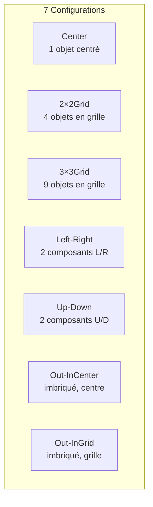
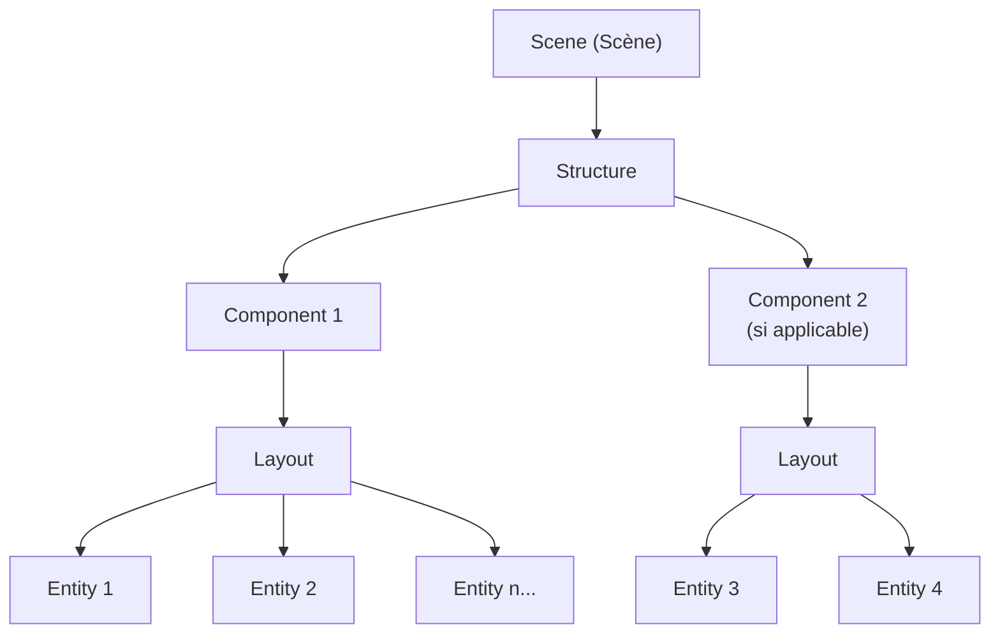

# RAVEN: A Dataset for Relational and Analogical Visual REasoNing

> **Paper**: Zhang, Gao, Jia, Zhu & Zhu — **CVPR 2019**
> **PDF**: [C:\Users\dhias\OneDrive\Desktop\Thèse\thesis_project\docs\literature\02_datasets_and_benchmarks\RAVEN a dataset for relational and rnalogical risual rEasoNing.pdf](file:///C:/Users/dhias/OneDrive/Desktop/Thèse/thesis_project/docs/literature/02_datasets_and_benchmarks/RAVEN%20a%20dataset%20for%20relational%20and%20rnalogical%20risual%20rEasoNing.pdf)
> **GitHub**: [WellyZhang/RAVEN](https://github.com/WellyZhang/RAVEN)

---

## 1. Motivation et Contexte

Les systèmes de vision par ordinateur excellent dans les tâches de perception de bas niveau (détection d'objets, suivi, etc.), mais peinent face aux problèmes de **raisonnement** de haut niveau. RAVEN aborde ce gap en s'inspirant des **Matrices Progressives de Raven (RPM)** — un test psychométrique classique d'intelligence fluide chez l'humain.

> [!IMPORTANT]
> RAVEN est le premier dataset RPM à fournir des **annotations de structure arborescente** (tree-structure), créant un lien sémantique entre perception visuelle et raisonnement structural.

## 2. Qu'est-ce qu'un problème RPM ?

Un problème RPM se présente sous la forme d'une **matrice 3×3** dont la dernière case (en bas à droite) est manquante. Le modèle doit trouver la bonne réponse parmi **8 candidats**.

```
┌───────────┬───────────┬───────────┐
│  Panel 1  │  Panel 2  │  Panel 3  │
├───────────┼───────────┼───────────┤
│  Panel 4  │  Panel 5  │  Panel 6  │
├───────────┼───────────┼───────────┤
│  Panel 7  │  Panel 8  │     ?     │
└───────────┴───────────┴───────────┘

Choix: [A] [B] [C] [D] [E] [F] [G] [H]  (8 candidats)
```

Les **règles** gouvernent les transformations qui s'appliquent **ligne par ligne** (row-wise).

## 3. Les 7 Configurations Figuratives

Chaque problème utilise une des 7 structures de disposition des objets dans chaque panneau :

| # | Nom Paper | Nom Dossier | Description |
|---|-----------|-------------|-------------|
| 1 | **Center** | `center_single` | Un seul objet centré dans le panneau |
| 2 | **2×2Grid** | `distribute_four` | 4 objets dans une grille 2×2 |
| 3 | **3×3Grid** | `distribute_nine` | 9 objets dans une grille 3×3 |
| 4 | **Left-Right** | `left_center_single_right_center_single` | 2 composants : gauche et droite |
| 5 | **Up-Down** | `up_center_single_down_center_single` | 2 composants : haut et bas |
| 6 | **Out-InCenter** | `in_center_single_out_center_single` | 2 composants : un externe (out) + un interne centré (in) |
| 7 | **Out-InGrid** | `in_distribute_four_out_center_single` | 2 composants : un externe + un interne en grille 2×2 |



## 4. Grammaire d'Images Stochastique avec Attributs (A-SIG)

Chaque problème est généré via une **grammaire d'images stochastique avec attributs (A-SIG)**. La structure hiérarchique est :



## 5. Attributs

Chaque **entité** (objet géométrique) possède 7 attributs :

### 5.1 Attributs gouvernés par des règles (Rule-Governing)

| Attribut     | Valeurs possibles                            | Description                     |
| ------------ | -------------------------------------------- | ------------------------------- |
| **Number**   | 1–9                                          | Nombre d'entités dans le layout |
| **Position** | Slots dans la grille                         | Quels emplacements sont occupés |
| **Type**     | triangle, carré, pentagone, hexagone, cercle | Forme géométrique               |
| **Size**     | 0.4, 0.5, 0.6, 0.7, 0.8, 0.9                 | Taille relative de l'objet      |
| **Color**    | 255→0 (10 niveaux de gris)                   | Couleur en niveaux de gris      |

### 5.2 Attributs de bruit (Noise)

| Attribut       | Description                                                            |
| -------------- | ---------------------------------------------------------------------- |
| **Uniformity** | Est-ce que les entités dans un panneau partagent les mêmes attributs ? |
| **Angle**      | Rotation propre de l'objet (-135° à 180°)                              |

## 6. Les 4 Types de Règles

Les règles s'appliquent **ligne par ligne** dans la matrice 3×3 :

| Règle | Description | Exemple |
|-------|-------------|---------|
| **Constant** | L'attribut reste identique sur toute la ligne | ○ → ○ → ○ |
| **Progression** | L'attribut change selon un pas constant (+1, +2, -1, -2) | △ → □ → ⬠ (arêtes: 3→4→5) |
| **Arithmetic** | Panel3 = Panel1 ± Panel2 | 2 + 3 = 5 (nombre d'objets) |
| **Distribute Three** | 3 valeurs distinctes distribuées sur chaque ligne | {rouge, vert, bleu} par ligne |
### 6.2 Les 8 regles
- 1) constant
- 2) progression : attribute+1
- 3) progression : attribute+2 
- 4) progression : attribute-1
- 5) progression : attribute-2
- 6) Arithmetic : Panel3 = Panel1 + Panel2
- 7) Arithmetic : Panel3 = Panel1 - Panel2
- 8) Distribute Three : 3 valeurs distinctes de l'attribut pour chaque ligne 

> [!NOTE]
> Chaque problème a en moyenne **6.29 règles** qui gouvernent simultanément différents attributs dans les composants.

### 6.2 Les contraintes des regles

|                  | Number | Position | Type | Size | Color |
| ---------------- | ------ | -------- | ---- | ---- | ----- |
| Contsant         |        | <br>     |      |      |       |
| Progression      |        | (*)      |      |      |       |
| Arithmetic       |        | (**)     |      |      |       |
| Distribute Three |        |          |      |      |       |
(\*) : Progression here means moving in Layout slots in order
(\**\*) : + means SET_UNION and - SET_DIFF
## 7. Structure des Fichiers NPZ

Chaque fichier `.npz` contient :

| Clé | Shape | Description |
|-----|-------|-------------|
| `image` | `(16, 160, 160)` | 16 images : les 8 premiers = matrice contexte, les 8 derniers = candidats réponse |
| `target` | scalaire (0-7) | Index de la bonne réponse dans les candidats (ajouter 8 pour l'index dans `image`) |
| `structure` | séquence | Annotation de structure arborescente (pré-ordre) |
| `meta_matrix` | matrice | Méta-données similaires à PGM |
| `meta_target` | vecteur | OR bit-à-bit de meta_matrix sur toutes les lignes |
| `meta_structure` | matrice | Structure méta-données |

### Comment les images sont organisées

```
image[0:8]  → Panneaux de la matrice contexte
               [0] [1] [2]    ← Ligne 1
               [3] [4] [5]    ← Ligne 2
               [6] [7]  ?     ← Ligne 3 (le 8ème est le trou)

image[8:16] → 8 candidats réponse
               Le correct est image[8 + target]
```

## 8. Organisation des Fichiers

```
dataset/
├── center_single/
│   ├── RAVEN_0_train.npz    ← Problème 0, split train
│   ├── RAVEN_0_train.xml    ← Annotations XML
│   ├── RAVEN_1_train.npz
│   ...
│   ├── RAVEN_N_val.npz      ← Split validation
│   ├── RAVEN_N_test.npz     ← Split test
├── distribute_four/
├── distribute_nine/
├── left_center_single_right_center_single/
├── up_center_single_down_center_single/
├── in_center_single_out_center_single/
└── in_distribute_four_out_center_single/
```

## 9. Résultats Clés

| Modèle | Accuracy Globale | Meilleur Config |
|--------|-----------------|-----------------|
| ResNet+DRT | **59.56%** | O-IC: 69.09% |
| ResNet | 53.43% | O-IC: 63.19% |
| CNN | 36.97% | O-IC: 43.20% |
| **Humain** | **84.41%** | Center: 95.45% |
| Solveur | 100% | Toutes |

> [!WARNING]
> Le gap humain-machine est de **~25%**, montrant que le raisonnement abstrait reste un défi majeur pour les réseaux de neurones modernes.

## 10. Limitation connue

Le dataset original RAVEN a une faille : la bonne réponse peut parfois être devinée par **vote majoritaire** des valeurs d'attributs sans regarder le contexte. Le dataset **I-RAVEN** (Improved RAVEN) corrige ce problème en équilibrant l'ensemble des réponses.

## 11. Points clés pour ta thèse

1. **Vision légère, Raisonnement lourd** — Les images sont simples (niveaux de gris, formes géométriques) pour forcer les modèles à se concentrer sur le raisonnement compositionnel
2. **Structure hiérarchique** — Les annotations arborescentes permettent de tester si un modèle peut exploiter des représentations structurées
3. **Diagnostic** — Le dataset est conçu pour diagnostiquer les faiblesses des systèmes de vision en mémoire à court terme et raisonnement compositionnel
4. **Extensible** — La grammaire attributive stochastique permet de générer de nouvelles configurations
